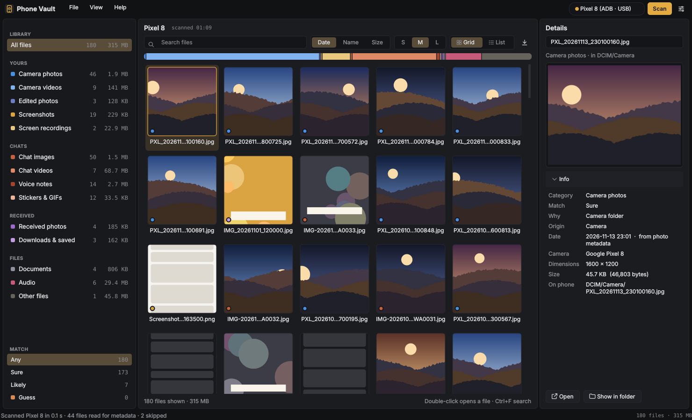
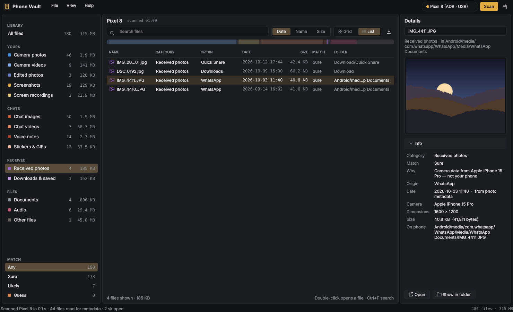
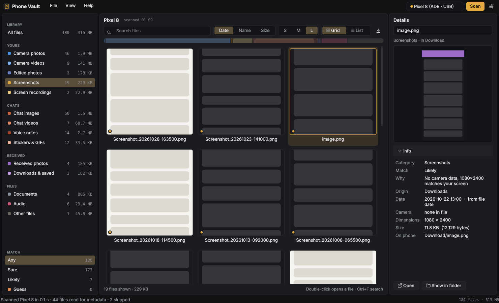
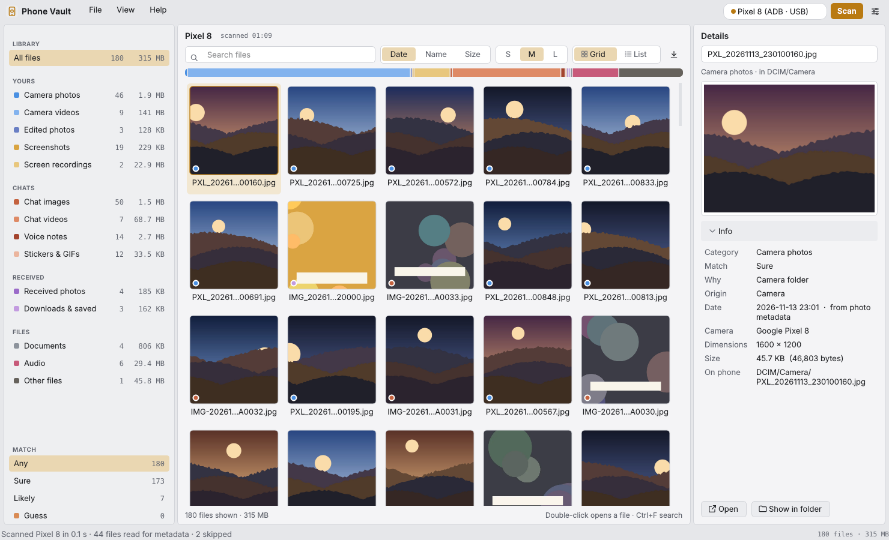

# Phone Vault

Back up the files on your Android phone to your Linux PC, sorted by what they actually are: photos you took, screenshots, chat media, things people sent you, and downloads. Built for Zorin OS. Works on any GNOME- or Ubuntu-based desktop.



> **Status: v0.1.0.** Phone Vault connects, scans and sorts, and shows a preview of the sorted library. It doesn't copy files yet. Backing up to your drive is the next milestone (see [handoff.md](handoff.md)).

## Features

- **Three ways to connect:** USB debugging (ADB, fastest), File transfer (MTP mounts that Zorin creates automatically), or any folder.
- **Automatic sorting** into 16 categories in four groups:
  - **Yours:** Camera photos, Camera videos, Edited photos, Screenshots, Screen recordings
  - **Chats:** Chat images, Chat videos, Voice notes, Stickers & GIFs (WhatsApp, WhatsApp Business, Telegram, Signal, Messenger, Viber, Discord)
  - **Received:** Received photos, Downloads & saved
  - **Files:** Documents, Audio, Other images, Other videos, Other files
- **Shows why each file was sorted where it is**, with a match level of *Sure*, *Likely* or *Guess*. Filter on *Guess* to review the uncertain ones.
- **Tells your photos from other people's** by comparing camera metadata with your phone's own camera, which Phone Vault learns from your camera folder.
- **Grid view with lazy thumbnails.** Over ADB it uses the photo's embedded thumbnail, so whole files aren't copied just to preview them.
- **List view** with sortable columns, and search across names, folders, apps, cameras and reasons.
- **Storage bar** showing what takes up space on the phone. Click a segment to filter to that category.
- **Details panel** with a preview, the reason for the category, origin, date and where it came from, camera, size and path on the phone.
- **Export to CSV** of whatever is currently shown.

## How sorting works

Each file is checked against these signals, strongest first:

| Signal | Example | Result |
|---|---|---|
| App media folder | `Android/media/com.whatsapp/WhatsApp/Media/WhatsApp Images/` | Chat images (`Sent/` = your own compressed copies) |
| Screenshot folder or name | `Pictures/Screenshots/`, `Screenshot_20261118-101010_Chrome.jpg` | Screenshots (Samsung names also give the app) |
| Camera folder | `DCIM/Camera/PXL_20261118_101010123.jpg` | Camera photos / videos |
| Camera metadata (EXIF) | Make `Apple`, Model `iPhone 15 Pro` in your Downloads | Received photos, because it isn't your camera |
| Pixel size | 1080 × 2400 with no camera data | Screenshot (*Likely*) |
| Folder fallbacks | `Download/`, `Recordings/`, `Music/`, `Documents/` | Downloads, Audio, Documents… |

**What about photos sent through WhatsApp?** A photo sent the normal way is recompressed and its camera metadata is removed, so it lands in *Chat images*. A photo sent **as a document** keeps the original file, including the sender's camera model. Phone Vault spots that the camera isn't yours and files it under *Received photos*.

Dates come from the photo metadata first, then the filename (`IMG_20261118_…`, `IMG-20261118-WA0001`), then the file's modified time.

## Install (Zorin OS / Ubuntu)

```bash
sudo apt install python3-venv adb      # adb is only needed for USB debugging scans
git clone https://github.com/ozzy-apps/phone-vault.git
cd phone-vault
./install.sh                           # venv + app menu entry + icon
```

Or run it straight from the folder without installing. The first run sets up `.venv`:

```bash
./run.sh
```

Optional HEIC/HEIF support: `.venv/bin/pip install pillow-heif`

## Connecting your phone

**USB debugging (recommended)**
1. On the phone, open *Settings → About phone* and tap *Build number* 7 times.
2. Open *Settings → System → Developer options* and turn on *USB debugging*.
3. Connect the cable and allow this computer on the phone.
4. The phone shows up in the device pill at the top right. Press **Scan**.

If the device shows *No USB permission*, run `sudo usermod -aG plugdev $USER`, log out and back in, then reconnect the cable.

**File transfer (MTP):** set the phone's USB mode to *File transfer*. Once Zorin mounts it, it appears in the device list.

**Any folder:** use *File → Choose folder…*, for example a copy of your phone storage you made earlier.

## Keyboard shortcuts

| Keys | Action |
|---|---|
| `F5` / `Esc` | Scan / stop scan |
| `Ctrl+R` | Refresh devices |
| `Ctrl+O` | Choose folder |
| `Ctrl+F` | Search |
| `Ctrl+1` / `Ctrl+2` | Grid / list view |
| `Ctrl+I` | Show or hide the details panel |
| `Ctrl+E` | Export the shown files as CSV |
| `Ctrl+,` | Settings |

## Customisation

Everything applies immediately and is saved in `~/.config/phone-vault/settings.json`.

- **Themes:** *Inca* (default, matching the Inca 3D app), *Inca Blue*, *Graphite* and *Light*.
- **Custom themes:** drop JSON files into `~/.config/phone-vault/themes/`. Any field you leave out falls back to the default theme, so this is already a complete theme:
  ```json
  { "name": "Mine", "accent": "#3d8bfd" }
  ```
  *Settings → New theme from current* writes a full template you can edit. The fields are `bg`, `surface`, `sidebar`, `field`, `surface_alt`, `raised`, `border`, `text`, `text_muted`, `accent`, `accent_text`, `sel_strong`, `sel_soft`, `warning` and `danger`.
- **Accent colour** override, **interface size** (80–150 %), and **density** (comfortable or compact).
- **Layout:** grid or list, thumbnail size S/M/L, sort by date, name or size, and the details panel on or off.
- **Sorting:** how much photo metadata to read (*Smart*, *All*, *Off*), plus your own camera models in case automatic detection misses one.
- **Scanning:** paths and patterns to skip, whether to include hidden files, and a custom `adb` location.

| | |
|---|---|
|  |  |
| *Received photos: the reason shows the sender's camera* | *A downloaded image recognised as a screenshot by its size* |
|  |  |
| *Light theme* | *Settings* |

## Project layout

```
phonevault/
  core/                 Qt-free logic, unit tested
    models.py           MediaFile, categories, confidence
    classifier.py       sorting rules and reasons
    metadata.py         EXIF/size probing from the first 128 KB of a file
    scanner.py          list → sort → probe → learn → sort
    settings.py         JSON settings, config/cache paths
    sources/            adb.py, folder.py (MTP/any folder), discovery.py
  ui/                   PySide6 interface (themes, style, views, panels)
tools/
  make_sample_phone.py  generates a fake phone for demos and tests
  capture_screenshots.py renders these README screenshots headlessly
tests/                  pytest suite
```

## Development

```bash
.venv/bin/pip install -e ".[dev]"
.venv/bin/python -m pytest
python3 tools/make_sample_phone.py /tmp/sample-phone       # then File → Choose folder…
QT_QPA_PLATFORM=offscreen python3 tools/capture_screenshots.py docs/screenshots
```

Versions follow [Semantic Versioning](https://semver.org). The version lives in `phonevault/__init__.py`, and changes are listed in [CHANGELOG.md](CHANGELOG.md). [handoff.md](handoff.md) holds the current state and the next steps.
